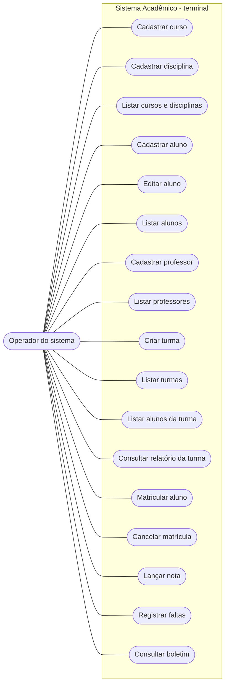

# Casos de uso

**Ator:** Operador do sistema. A aplicação não possui autenticação; o ator representa a pessoa que utiliza os menus locais.

O desenho usa flowchart Mermaid para representar as funcionalidades oferecidas pelos menus; não é um diagrama de casos de uso UML desenhado com notação gráfica UML formal.
