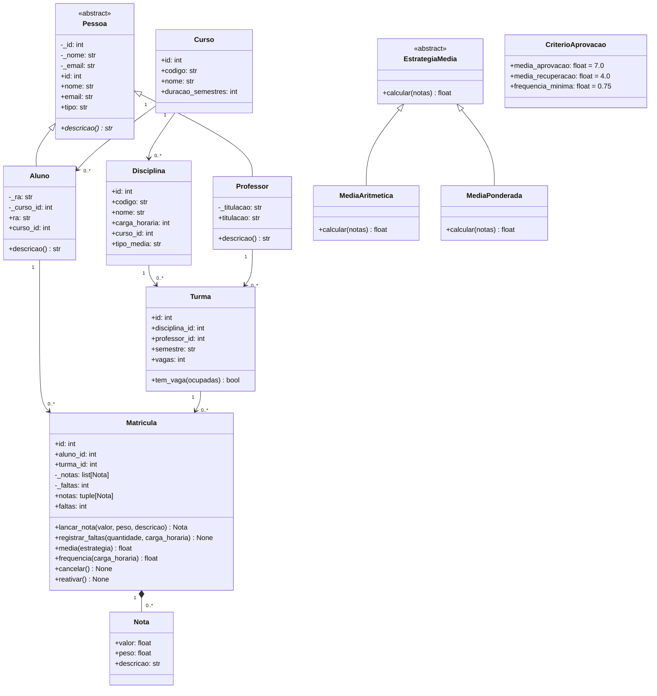

# Diagrama de classes do domínio

Diagrama baseado nas classes presentes em `src/sistema_academico/dominio/`. Os serviços e repositórios não foram incluídos para manter o foco nas entidades e estratégias do domínio.

`Nota` e `CriterioAprovacao` são dataclasses congeladas. `Pessoa` e `EstrategiaMedia` são classes abstratas. A relação de `Curso` com `Aluno` ocorre por `Aluno.curso_id`.
