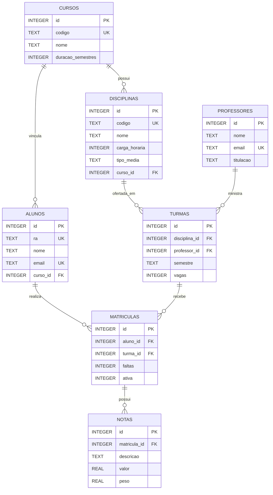

# Diagrama entidade-relacionamento

Diagrama derivado das sete tabelas declaradas em `database/schema.sql`.

As restrições de unicidade e os `CHECK` estão descritos em `../arquitetura/modelo_banco.md` e no próprio `database/schema.sql`.
